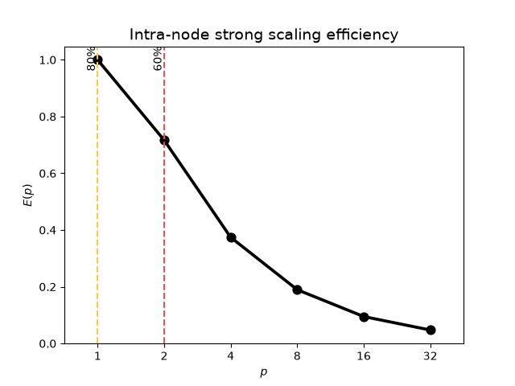
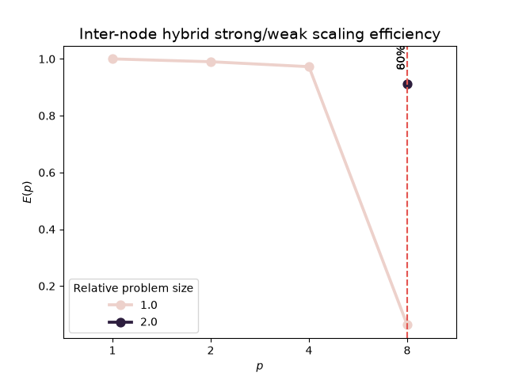
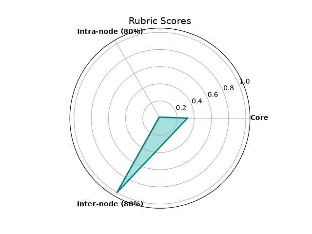

# SHAREing: High-level performance assessment report template

As recommended in the [pre-assessment](pre-assessment-report.md), the high-level assessment was performed by Thomas Flynn between the 15/10/26 and `<end_date>`.

The submitter has specified that out of the five performance dimensions, the ones relevant to this assessment and benchmark are:

- [x] [Core-level assessment](#2-core-level-assessment)
- [x] [Intra-node assessment](#3-intra-node-assessment)
- [ ] [Inter-node assessment](#4-inter-node-assessment)
- [ ] [GPU-performance assessment](#5-gpu-performance-assessment) (Pending pre-assessment)

We provide brief explanations of the high-level metrics in their relevant sections. However, for a more detailed description, please refer to Chapter 5 in the [performance assessment guidebook](https://shareing-dri.github.io/assets/pdfs/perf_analysis_workbook_brief.pdf).

## Table of contents

- [SHAREing: High-level performance assessment report template](#shareing-high-level-performance-assessment-report-template)
  - [Table of contents](#table-of-contents)
  - [1. Setup Details](#1-setup-details)
    - [1.1 Programming model](#11-programming-model)
    - [1.2 SLURM configuration](#12-slurm-configuration)
    - [1.3 Base input](#13-base-input)
  - [2. Core-level assessment](#2-core-level-assessment)
  - [3. Intra-node assessment](#3-intra-node-assessment)
  - [4. Inter-node assessment](#4-inter-node-assessment)
  - [5. GPU-performance assessment](#5-gpu-performance-assessment)
  - [6. I/O Assessment](#6-io-assessment)
  - [7. Summary](#7-summary)
  - [8. High-level assessment outcome](#8-high-level-assessment-outcome)

## 1. Setup Details

As the code was [successfully compiled on gi001](pre-assessment-report-CPU.md#3-description-of-working-environment) during the pre-assessment, though DINE2 was used for the high-level assessment using the same setup, compilers and modules as described [there](pre-assessment-report-CPU.md#3-compiler-setup-and-optimisations).

### 1.1 Programming model

The compiled code uses OpenMP+MPI for both intra-node and inter-node runs. The submitter indicated a one MPI rank per NUMA domain preference if NUMA awareness is specified.

### 1.2 SLURM configuration

All analyses were performed on an exclusive node on DINE2 with the following example configuration of 2 MPI ranks with 16 OpenMP threads each

```bash
#SBATCH --partition=dine2
#SBATCH --account=do015

#SBATCH --ntasks-per-node=2
#SBATCH --cpus-per-task=16
#SBATCH --nodes=1
#SBATCH --exclusive
#SBATCH --distribution=block:block
```
For intra-node runs, the `--ntasks-per-node` and `--cpus-per-task` values are set to the number of MPI ranks and OpenMP threads respectively. For inter-node runs, the `--nodes` value is varied.

MPI ranks are distributed in a `block:block` configuration. The following directives were used for OpenMP thread distribution:

```bash
export OMP_NUM_THREADS=$SLURM_CPUS_PER_TASK # Set with --cpus-per-task
export OMP_PLACES=cores
export OMP_PROC_BIND=close
```

### 1.3 Base input

The following is the input configuration used for serial runs:

```bash
./qft 29
```

## 2. Core-level assessment

For a high-level analysis of a single core's performance, we look for the floating-point operation rate compared to the theoretical rate, $R^{core}\_{theoretical}$ for a core. The hardware capabilities were determined with `likwid-bench` pinned to a single core on the first socket of a node:

```bash
likwid-bench -t peakflops -w S0:24kB:1
```

where we have used the "half of the L1 cache" rule-of-thumb.

To analyse the performance of a single core, the code was run on one rank and thread with `likwid-perfctr` to get the observed floating point rate, with the [serial input indicated earlier](#13-base-input):

```bash
# Change accordingly for the code being assessed
likwid-perfctr -f -C 0 -g FLOPS_DP ./qft 29
```

Despite running on a single core, the job was given access to an exclusive node with all cores. Note that this run was a truly serial configuration of the code with no MPI or OpenMP capabilities enabled. 

|       Metric               | MFLOPS    |
| -------------------------- | --------- |
| $R^{core}\_{theoretrical}$ | 6780.01   |
| $R^{core}\_{observed}$     | 1796.1881 |

However, with the `BMI2` option enabled we get 

|       Metric               | MFLOPS    |
| -------------------------- | --------- |
| $R^{core}\_{theoretrical}$ | 6757.06   |
| $R^{core}\_{observed}$     | 2165.9999 |

Note the $R^{core}\_{theoretrical}$ differs simply because of inherent variability with the system. Hence, we proceed with the `BMI2` option enabled.

Based on these results, we determined that this software has a score of $C^{core} = \frac{R_{observed}}{R_{theoretical}}\approx$ 0.32. As per the rubric, the metric is classified as follows:

| Peak FLOPS proportion | Description | Score |
| -------------------------- | ---------------------------------------------------------------------------------------------------------------------------------------- | ----- |
| $C_{core} \ge$ 0.8 | <span style="background-color: #0080005f">Core performance does not require further analysis.</span> | |
| 0.8 $\gt C_{core} \ge$ 0.6 | <span style="background-color: #ffff005c">Core performance may require further analysis as it may not be effectively using the hardware to its maximum potential.</span> | |
| 0.6 $\gt C_{core}$ | <span style="background-color: #ff00004e">Core performance requires in-depth analysis.</span> | $C_{core} \approx$ 0.32 |

Whilst this is higher than the $\approx$ 0.26 without the `BMI2` option enabled, this metric shows that the code achieves less than 60% of a single core's achievable peak performance, indicating that this aspect requires deeper analysis.

## 3. Intra-node assessment

For a high-level analysis of the intra-node performance, we perform a strong scaling by fixing the problem size and increasing core allocation. Note, the benchmark by default performs two runs and times them internally. We check that these times are consistent and then use the second runtime (in seconds) as our **Time** data.

| Cores | Ranks | Thread per rank | Time (s) | Parallel efficiency (%) |
| ----- | ----- | --------------- | -------- | ----------------------- |
| 1     | 1     | 1               | 400.473  | 1                       |
| 2     | 1     | 2               | 279.382  | 0.716712                |
| 4     | 1     | 4               | 267.522  | 0.374243                |
| 8     | 1     | 8               | 264.053  | 0.18958                 |
| 16    | 1     | 16              | 263.717  | 0.0949107               |
| 32    | 1     | 32              | 264.196  | 0.0473693               |



The 80% threshold is at 1 core and the 60% threshold is at 2 cores. As a proportion of the number of cores available on the node i.e. 64, the scores are:

$$
C^{80\\\%}_{intra}=\frac{p^{80\\\%}_{critical,intra}}{p_{max,intra}}=\frac{1}{64}=0.015625
$$

and

$$
C^{60\\\%}_{intra}=\frac{p^{60\\\%}_{critical,intra}}{p_{max,intra}}=\frac{2}{64}=0.03125
$$

| Efficiency                                                 | Description | Score |
| ---------------------------------------------------------- | ----------- | ----- |
| $C^{80\\\%}_{intra} \ge$ 0.8                                 | <span style="background-color: #0080005f">Shared memory scaling does not require further analysis.</span> |   |
| $C^{80\\\%}_{intra} \lt$ 0.8 ^ $C^{60\\\%}\_{intra} \ge$ 0.6    | <span style="background-color: #ffff005c">Shared memory scaling may require analysis; scaling performance may be impacted when porting to newer chips with more cores.</span> |   |
| otherwise                                                  | <span style="background-color: #ff00004e">Shared memory scaling requires in-depth analysis.</span> |$C^{80\\\%}_{intra} \approx$ 0.015625 & $C^{60\\\%}\_{intra} \approx$ 0.03125|

Based on the classification of the metrics and observations from the parallel efficiency plot, the code demonstrates unfavourable scaling within a node with this configuration. The intra-node performance therefore requires further investigation.

## 4. Inter-node assessment

> [!IMPORTANT]
> Include a brief description of the inter-node rubric. Provide more details on the programming model used for this code and assessment. Describe the initial problem size, and how it is scaled when the efficiency drops below 60%.

The inter-node performance is measured using a combination of strong and weak scaling analyses. For a given problem size, a strong scaling analysis is performed over increasing node counts, with the parallel efficiency computed with respect to the performance on a single node. When the efficiency drops below 60%, the problem size is increased relative to the initial size. The run is repeated with the new size for that node count, and the strong scaling analysis is continued over the remaining node counts. The step is repeated every time the efficiency falls below 60%.

> [!IMPORTANT]
> Change the table headers and content according to the programming model used e.g. MPI only, OpenMP only, GPU + MPI etc. The "problem size" entry is relative i.e. the starting size will be 1, and if it is doubled when the parallel efficiency drops below 60%, it will be 2.

| Nodes | Ranks | Threads per rank | Problem size | Time (s) | Parallel efficiency (%) |
| ----- | ----- | ---------------- | ------------ | -------- | ----------------------- |
| 1     | 8     | 16               |              |          |                         |
| 2     | 16    | 16               |              |          |                         |
| 3     | 24    | 16               |              |          |                         |
| 4     | 32    | 16               |              |          |                         |
| 5     | 40    | 16               |              |          |                         |
| 6     | 48    | 16               |              |          |                         |
| 7     | 56    | 16               |              |          |                         |
| 8     | 64    | 16               |              |          |                         |



> [!IMPORTANT]
> Highlight any observations made from the inter-node runtimes and graph. Compute the scores using the metrics generated with the `assessmenttemplate` package and the `high-level-plots.py` script and plug the values in the equation below.

At `<N_example>` nodes, the parallel efficiency fell below 60% and so the problem size was doubled. The 80% threshold is at `<p_80>` cores and the 60% threshold is at `<p_60>` cores. As a proportion of the number of cores available on the node i.e. `<num_cores_per_node>`, the scores are:

$$
C^{80\\\%}_{inter}=\frac{p^{80\\\%}_{critical,inter}}{p_{max,inter}}=\frac{\texttt{<p\\\_80>}}{\texttt{<num\\\_cores\\\_per\\\_node>}}=\texttt{c\\\_80}\\\%
$$

and

$$
C^{60\\\%}_{inter}=\frac{p^{60\\\%}_{critical,inter}}{p_{max,inter}}=\frac{\texttt{<p\\\_60>}}{\texttt{<num\\\_cores\\\_per\\\_node>}}=\texttt{c\\\_60}\\\%
$$

| Efficiency | Description | Score |
| ---------- | ----------- | ----- |
| $C^{80\\\%}_{inter} \ge$ 0.8 $.C\_{inter}$ ^ $C^{80\\\%}\_{inter} + C^{60\\\%}\_{inter}=C\_{inter}$ | <span style="background-color: #0080005f">Distributed memory scaling does not require further analysis.</span> | $C^{80\\\%}\_{inter} \approx$ `<c_80>` & $C^{60\\\%}\_{inter} \approx$ `<c_60>` |
| $C^{60\\\%}\_{inter} \ge$ 0.6 $.C\_{inter}$ | <span style="background-color: #ffff005c">Distributed memory scaling may require further analysis.</span> | |
| otherwise | <span style="background-color: #ff00004e">Distributed memory scaling requires in-depth analysis.</span> | |

> [!IMPORTANT]
> Place the inter-node score in the correct range. Contextualise and elaborate on the classification of the score.

## 5. GPU-performance assessment

> [!IMPORTANT]
> Include a brief description of the GPU rubric. Provide details on the configurations and metrics collected from it. This rubric needs to be further generalised for other vendors such as AMD and accelerators such as FPGAs.

For a high-level analysis of a single GPU's performance, we look for the floating-point operation rate compared to the theoretical rate, $R^{GPU}_{theoretical}$ for the GPU, which can be obtained from [its specifications](https://www.nvidia.com/en-sg/data-center/h100/).

> [!TIP]
> The example uses NVIDIA H100s. Check the specifications for the GPU you are using for the assessment.

To analyse the performance of a single GPU, the code was compiled with the latest version of CUDA and NVHPC available on `<cluster_name>`. For this metric, the code was run on a single GPU and assigned the [input indicated earlier](#13-base-input) with the following modifications:

```txt
<example_gpu_input>
```

The following command was used to obtain the metrics required:

```bash
# Change accordingly for the code being assessed
ncu --metrics "regex:ˆsm_.*d_op_(d|f[ˆp]|h).*\\.sum$" --csv --log-file out.csv $EXEC $INPUT
```

|       Metric                                         | # operations  |
| ---------------------------------------------------- | ------------- |
| `sm__sass_thread_inst_executed_op_dfma_pred_on.sum`  |               |
| `sm__sass_thread_inst_executed_op_dmul_pred_on.sum`  |               |
| `sm__sass_thread_inst_executed_op_ffma_pred_on.sum`  |               |
| `sm__sass_thread_inst_executed_op_fadd_pred_on.sum`  |               |
| `sm__sass_thread_inst_executed_op_fmul_pred_on.sum`  |               |
| `sm__sass_thread_inst_executed_op_fmul_pred_on.sum`  |               |
| `sm__sass_thread_inst_executed_op_hfma_pred_on.sum`  |               |
| `sm__sass_thread_inst_executed_op_hadd_pred_on.sum`  |               |
| `sm__sass_thread_inst_executed_op_hmul_pred_on.sum`  |               |

The total runtime for the configuration without profiling was `<gpu_runtime>`.

>
> [!IMPORTANT]
> Total the number of operations for each category and use the runtime without profiling to get the observed floating point rate. Add that to the table below along with the theoretical rate from the specifications of the GPU being used.
>
The observed and theoretical floating point rates were:

|       Metric              | MFLOPS                             |
| ------------------------- | ---------------------------------- |
| $R^{GPU}_{theoretrical}$  |                                    |
| $R^{GPU}_{observed}$      | $\frac{\sum N_{opers}}{T_{exec}}=$`<gpu_observed>` |

Based on these results, we determined that this software has a score of $C^{GPU} = \frac{R_{observed}}{R_{theoretical}}\approx$ `<gpu_score>`. As per the rubric, the metric is classified as follows:

| Peak FLOPS proportion | Description | Score |
| -------------------------- | ---------------------------------------------------------------------------------------------------------------------------------------- | ----- |
| $C_{GPU} \ge$ 0.8 | <span style="background-color: #0080005f">GPU performance does not require further analysis.</span> | |
| 0.8 $\gt C_{GPU} \ge$ 0.6 | <span style="background-color: #ffff005c">GPU performance may require further analysis as it may not be effectively using the hardware to its maximum potential.</span> | |
| 0.6 $\gt C_{GPU}$ | <span style="background-color: #ff00004e">GPU performance requires in-depth analysis.</span> | $C_{GPU} \approx$ `<gpu_metric>` |

> [!IMPORTANT]
> Place the GPU-performance score in the correct range. Contextualise and elaborate on the classification of the score.

## 6. I/O Assessment

No I/O assessment was performed, at this time.

## 7. Summary

The following table collates the results of all above sections. These scores are indicative only, and cannot truly be compared to one another meaningfully without taking into account domain knowledge and methodological differences between them.

| Result | Score | Metric result |
| ---------------- | - | - |
| [Core](#2-core-level-assessment) | `<core_score>` | MFLOPS |
| [Intra-node (80%)](#3-intra-node-assessment) | `<c_80>` | core(s) |
| [Inter-node (80%)](#4-inter-node-assessment) | `<c_80>` | node(s) |
| [GPU](#5-gpu-performance-assessment) | `<gpu_score>` | MFLOPS |

> [!IMPORTANT]
> Use the score table above to generate the spiderweb plot for the summary using the `assessmenttemplate` package and the `high-level-plots.py` script.



## 8. High-level assessment outcome

> [!IMPORTANT]
> Comment on the outcome of the high-level assessment. Indicate on which rubrics will be looked into in a low-level analysis and why.
